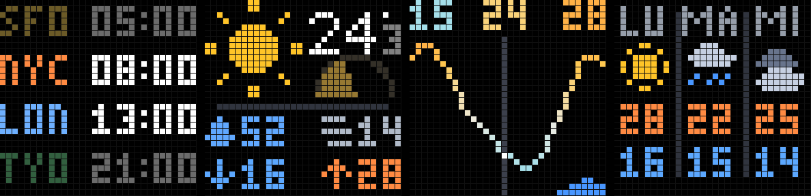
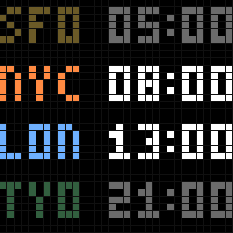
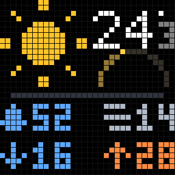
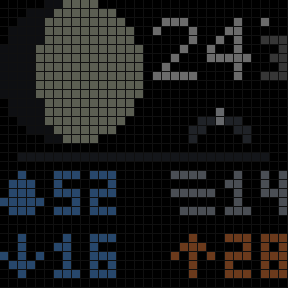
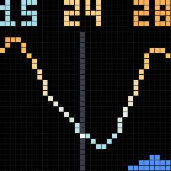
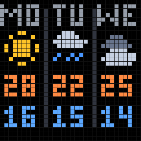
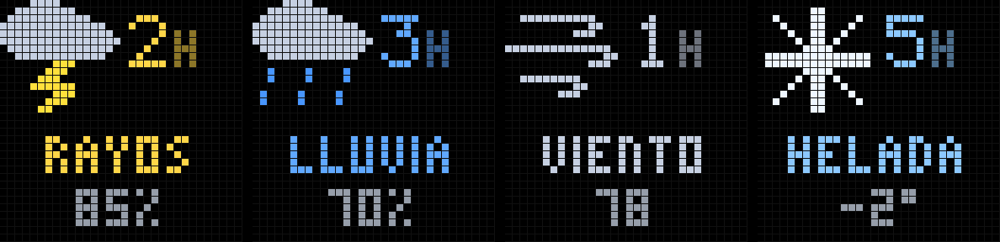

# ledclock



Turns a **B.K.Light "LED pixel board" (MAL ACT1026)** — a €15 32×32 RGB matrix
that only speaks to a phone app — into a desk display driven from macOS over
Bluetooth Low Energy.

The panel's own firmware offers a clock and some animations. `ledclock` ignores
all of it: it renders its own 32×32 frames on the Mac and pushes them as PNGs,
so the display can show anything Python can draw. World clocks that dim where
it is night, real weather, a temperature graph, storm warnings, the phase of
the moon and where it currently sits in the sky.

Weather comes from [Open-Meteo](https://open-meteo.com) — free, no API key. The
sun and moon are computed locally, so those pages keep working with no network.

## What it shows

| | |
|---|---|
|  | **World clocks.** Four zones, sorted west to east by live UTC offset. Rows where it is night are dimmed against *that city's* own sunrise and sunset. |
|  | **Weather now.** Condition, temperature to a tenth, and a configurable 2×2 grid of stats. The arc under the temperature is the sun's path through today. |
|  | **After dark** the hero becomes the real phase of the moon, and the arc becomes the moon's actual track — east on the left, west on the right, height is altitude. The dot only appears when the moon is genuinely above the horizon. |
|  | **Trend.** 24 hours centred on now. Colour is temperature on an absolute ramp; the band underneath is the chance of rain, yellow under thunder. |
|  | **Forecast.** Three days: weekday, condition, high and low. |

An **alert** page joins the rotation only when something is coming, and jumps
the queue the first time it appears:



## The menu bar app


A status item to steer the carousel without waiting for a page to come round —
transport controls, and per-page **show / only this / never this**. The icon is
the temperature curve, drawn as a template image so it takes the menu bar's own
colour in light and dark. It dims while paused and falls to a dashed line when
the panel is unreachable.

## Requirements

- macOS (Apple Silicon or Intel), Python 3.11+
- A B.K.Light ACT1026 or another panel speaking the iPixel Color protocol
- USB power for the panel, 5 V and 2 A or better

## Install

```bash
git clone https://github.com/CarlosLopezRoa/ledclock.git
cd ledclock

python3.13 -m venv .venv
.venv/bin/pip install -e .
tools/make_app_bundle.sh                            # see "Bluetooth on macOS"
ln -sf "$PWD/bin/ledclock" ~/.local/bin/ledclock    # optional: run from anywhere

cp config.example.yaml config.yaml
./bin/ledclock scan                                 # copy the address into config.yaml
./bin/ledclock probe                                # expect 32x32, device_type 129
tools/install_agent.sh                              # daemon + menu bar, at login
```

`config.yaml` is deliberately untracked. Coordinates past about three decimal
places identify a building, so keep yours out of anything you publish — the
screenshots above are generated from invented weather by
`tools/make_screenshots.py` for the same reason.

Symlinking `bin/ledclock` rather than aliasing it keeps the command working in
scripts and non-interactive shells, not just at an interactive prompt. Re-run
`tools/make_app_bundle.sh` if the project ever moves — the launcher hard-codes
absolute paths, and the symlink will follow it.

## Use

Always invoke through `bin/ledclock`, not the venv's entry point — see below.

```bash
./bin/ledclock agent status       # is the daemon up? plus the tail of its log
./bin/ledclock agent stop         # free the panel for a hands-on command
./bin/ledclock agent restart      # pick up an edited config.yaml
./bin/ledclock agent logs         # follow the log
./bin/ledclock scan               # find the panel, prints its address
./bin/ledclock probe              # connect; should report 32x32, device_type 129
./bin/ledclock cities             # dump what iStat Menus knows
./bin/ledclock preview --open     # render every page to PNG, no hardware needed
./bin/ledclock test-pattern       # colour quadrants: checks orientation + channel order
./bin/ledclock page world_clocks  # render one page and send it once
./bin/ledclock clock              # hand over to the panel's own firmware clock
./bin/ledclock show-slot 1        # display a stored slot
./bin/ledclock run                # the carousel daemon
```

Put the address from `scan` into `config.yaml` under `device.address`.

### Designing pages

`preview` is the fast loop: it renders to a scaled-up PNG with a pixel grid
and never touches the panel.

```bash
./bin/ledclock preview --page forecast --scale 16 --open
```

Add a page by writing a function that returns a `Canvas` and registering it in
`PAGES` in `ledclock/pages.py`; then add its name to `display.pages`.

### Tests

```bash
.venv/bin/python -m unittest discover -s tests
```

Fonts and icons are literal grids typed by hand, so the tests mostly check
that no row is a character too long — a mistake that is invisible in the
source and merely shifts pixels sideways on the panel. They also render every
page with and without weather data, and check the frame encoding against
bytes captured from the real device.

## The trend graph

A 24-hour window centred on now (`display.trend_hours`), which is wide enough
to show the whole daily arc — the overnight low, the afternoon peak, and where
you currently sit on it.

Two things are being said at once, so they get separate visual channels rather
than fighting over one:

**Hue is temperature**, on an *absolute* ramp defined in `render.py`: deep blue
below freezing, near-white around 20 °C, red past 35. Absolute on purpose — if
the colours rescaled to each window, the same shade would mean a frosty morning
one day and a heatwave the next. Fahrenheit readings are converted back before
the ramp sees them.

**Nothing else touches the line.** The forecast half used to be dimmed to set
it apart from the measured half, and that quietly broke the colour: knocking
back a warm colour makes it read browner, so a *cooler* forecast point came out
looking *redder* than the warmer present one — 28.9 °C drawn as `(140,91,36)`
beside 29.9 °C as `(255,154,60)`. Brightness and hue were both in play and they
fought. The dimming is gone; the vertical marker at the centre, which now runs
the full height of the page, is what separates measured from forecast.

**Rain gets its own band** along the bottom three rows, bar height by chance,
recoloured yellow under thunder. It could not go into the line's colour: blue
already means cold there, and "blue because cold" against "blue because wet" is
unreadable.

The band ignores anything under `RAIN_MIN_PROBABILITY` (15%). Open-Meteo
reports plenty of 3% and 8% hours, and giving each a bar made a dry day look
showery.

The header is three readings — **coolest, current, warmest**, left to right —
each drawn in the colour the ramp gives it. That makes it the graph's legend
as well as its scale: the same temperature is the same colour in both, so the
numbers explain the line without an axis, and their left-to-right order says
which is which without arrows.

The middle figure comes from the API's current observation rather than the
interpolated curve, so it agrees with the big number on `weather_now`; the two
track each other to a rounding error. In a deep freeze, where three wide
readings would overrun 32 px, the middle one stands down — the marker on the
curve still shows where you are.

The vertical axis pads out to a minimum of 3 °C so that a flat night is drawn
flat rather than amplified into drama, but the labels always report the real
extremes — the padding is scaffolding, not data.

### A shown bound has to actually bound

The header once read **`23 · 35 · 34`** — a current temperature above the
maximum. Two separate causes:

*Rounding to nearest.* A peak of 34.4 printed as `34` while the observation of
34.8 printed as `35`. Maxima now round **up** and minima **down**
(`format_high` / `format_low` in `sources/weather.py`), so a displayed range
always contains what it claims to. Point readings — the current temperature,
humidity, wind — still round to nearest, because they are not bounds.

*Two different sources.* The middle figure is the API's current observation, a
15-minute product, while the curve is hourly means; at a sharp peak the
observation can sit above every point on the line. It is now folded into the
window's extremes, so the header cannot contradict itself.

The same outward rounding applies wherever a bound is shown: the forecast
columns, the `low`/`high` stat cells, and a frost alert — where `-0.4` printed
as `0` would have hidden the whole point of the warning.

## The sun's path

`weather_now` shows the apparent temperature only when it differs from the
real one by more than a degree. The rest of the time that slot holds the sun's
day instead: a dome with sunrise at the left foot, solar noon at the top and
sunset at the right, filled in as the day is spent — a wedge that starts as a
sliver at dawn and reaches half a disc at dusk.

Area reads faster than position. An earlier version drew a dot travelling
along the outline, which made you find the dot and then judge where along the
line it sat; a filled wedge answers "how much daylight is left" at a glance.
What is left of the day stays as an outline, so there is something to fill
toward — filling both halves in solid was tried first and read as one dark
mass with a bright corner.

How far it has filled is the fraction of daylight elapsed, so the same dome
fills over nine hours in December and fifteen in June — the season shows up as
speed.

`display.sun_arc_seasonal` (on by default) also puts the season in the
*shape*, scaling the arc's height by the sun's noon altitude: about 24° at
43° north in midwinter against 70° in midsummer, which flattens the
arc to a low dome and then lifts it into a tall one. Speed you only notice over
hours; height reads at a glance. Set it to `false` for a plain half-circle
every day.

### After dark: where the moon actually is

The same slot switches to the moon, but **not** as another progress arc. The
first version ran sunset to sunrise with a moon-shaped marker on it, which was
tidy and wrong: the moon does not cross the sky in step with the night, and
the question worth answering is *is it out, and where do I look*.

So `moon.position()` solves for real altitude and azimuth from a low-precision
lunar series, and the slot plots them directly. Horizontal is compass bearing
— east at the left, south in the middle, west at the right. Vertical is
altitude above the horizon, so a low moon hugs the bottom and a high one arcs
over.

The faint track is the moon's whole pass; the bright dot is the moon, and it
is **only drawn when the moon is genuinely above the horizon**. An empty track
therefore means it has not risen yet, and its left end is where it will come
up.

Two independent calculations cross-check each other in the tests: a full moon
must be high at midnight and below the horizon at noon, and a new moon the
other way round. The phase series and the position series agree, which neither
could fake alone.

Nothing is drawn while the sun is up — a sun parked on the horizon all night
would say less than an empty slot, and so would a moon.

## Alerts

`ledclock/alerts.py` watches the hourly forecast for four things — thunder,
rain, gusts and frost — and the `alert` page joins the rotation only while one
is live. A brand-new alert jumps the queue rather than waiting out a full
rotation, since a warning you see a minute later is not much of a warning.

```yaml
alerts:
  lookahead_hours: 6
  rain_probability: 60
  gust_kmh: 55
  frost_celsius: 2
  hold_minutes: 30
```

Three design points are worth more than the detection itself:

**Lead time is the payload.** "Rain" is decoration; "rain in three hours" is
something you act on, so every alert carries it and it gets the big font.

**Not crying wolf.** A gust of 56 km/h against a 55 threshold would flip the
page on and off at every refresh, so alerts latch: once raised they stay for
`hold_minutes` regardless of what the reading does next.

**Rain needs two signals.** Open-Meteo will report a drizzle weather code at
0% precipitation probability, so an alert wants both a wet code *and* a real
chance. Rain already falling is not an alert either — you can hear it.

Labels are constrained by the 32-pixel width: `TORMENTA` measures 33px (its M
alone is five wide) and arrived on the panel as `TORMENT`, so the storm alert
says `RAYOS`.

## Brightness, day and night

Two independent levels, both absolute. They exist because the panel's own
brightness command bottoms out at 1 — which is still bright in a dark room.

```yaml
display:
  gain: 0.55         # daytime level
  night_gain: 0.42   # level between local sunset and sunrise
```

`gain` scales every pixel just before the frame is encoded, so it reaches
below firmware brightness 1 and does so continuously rather than in 100 steps.
Channel ratios are preserved, so hues survive; genuinely dark colours round
away to black.

`night_gain` is an **absolute** target, not a factor on top of `gain`. That
distinction is the whole point: the two used to multiply, so at `gain: 0.4` a
night row landed at 0.4 × 0.42 = 17% of full and disappeared off the panel.
`pages.night_factor()` divides the global gain back out so the night level
lands where it was asked, and clamps at 1.0 so night can never outshine day.
Raising or lowering `gain` therefore leaves nights exactly where they were.

**Where day and night come from.** Not from a pair of hardcoded hours — real
sunset moves by hours across the year, and by far more across the time zones
on the world-clock page. `ledclock/sun.py` solves the sunrise equation from
latitude and longitude; it agrees with Open-Meteo to within about two minutes
everywhere it was checked, including Reykjavík and Sydney. Doing the maths
rather than reading the API's `sunrise`/`sunset` keeps it working offline and
covers the world-clock cities without four extra requests.

The rule applies to **every page**, except that `world_clocks` opts out
(`pages.SELF_DIMMING`) because it already dims each row against *that city's*
sun — applying the page-level rule too would dim night rows twice.

Give each city `lat`/`lon` in `config.yaml` to get real sunrise/sunset for its
row; without them the row falls back to fixed evening/morning hours.

To try levels without editing anything (stop the agent first — only one thing
can hold the panel):

```bash
./bin/ledclock page world_clocks --gain 0.25
```

## Steering it, in detail

A small status item for steering the carousel without waiting for a page to
come round: next, previous, pause, and per-page control.

```
▣ ▾
├─ Tendencia                     ← what is on the panel now
├──────────────
├─    ◀◀    ❚❚    ▶▶            ← transport row
├──────────────
├─ Páginas
│    ✓ Relojes
│    ✓ Clima
│    ✓ Tendencia — sola
│      Pronóstico
├──────────────
├─ Abrir config.yaml
├─ Reiniciar el daemon
└─ Salir
```

The transport row is an `NSMenuItem` carrying a custom `NSView`, because a
menu row cannot hold three buttons on its own. A useful side effect: the menu
stays open when they are clicked, and stepping through pages is something you
do several times in a row.

**Stepping does not resume.** Pausing says "I am steering now", so Next and
Previous move between pages and leave the pause in place — having them hand
control back to the carousel would undo the thing you just asked for. Only the
play button resumes, and resuming moves on rather than repeating the page you
stopped on.

Clicking a page cycles it: **shown → only this one → never this one → shown**.
One control instead of three, in the order you actually reach for them.

The same thing from the terminal, over the same socket, so the two can never
disagree:

```bash
ledclock show status
ledclock show next
ledclock show pin trend
ledclock show disable forecast
```

### The icon is the panel

The daemon hands back the exact frame it last pushed, and that is what gets
drawn in the menu bar. Text is unreadable at 18 points, but the colour
signature is not: four coloured rows is the world clocks, a big block on the
left is the weather page, a curve is the trend. It dims while paused and goes
to a hollow outline when the link is down.

That is deliberate rather than decorative. Everything else this project knows
— temperature, conditions, clocks — is already on the menu bar via iStat
Menus. The one thing nothing else can show is **what the panel is doing right
now**, so that is what the icon shows.

### How it talks to the daemon

The panel accepts one BLE client and the daemon holds it, so the app cannot
reach the hardware. It talks to the daemon over a Unix socket at
`~/Library/Application Support/ledclock/control.sock` — newline-delimited
JSON, unreachable from the network by construction, no port to collide.

A consequence worth noting: **the menu bar app never touches Bluetooth**, so
none of the CoreBluetooth and TCC trouble below applies to it. It gets its own
bundle only because `LedClock.app` is `LSBackgroundOnly`, which forbids any UI
at all — a status item included. `LedClockMenu.app` is `LSUIElement` instead:
menu bar presence, no Dock icon.

A pinned page does **not** silence alerts. A fresh warning jumps the queue
ahead of the pin and then hands the panel back — one suppressed because you
were looking at something else would be no warning at all.

## What happens when the Mac goes away

The panel holds the last frame it was sent, indefinitely. Harmless for a
weather page; actively misleading for a clock, since a frozen 22:47 is worse
than no clock at all.

It is not purely a dumb screen, though. It has an RTC and a firmware clock
mode that keeps correct time with **nothing connected** — verified against the
hardware. So whenever the daemon *knowingly* lets go, it hands the display
over to that clock first (`device.idle_mode`, default `clock`).

| Situation | What the panel does |
|---|---|
| Daemon stopped, logout, shutdown or restart | launchd sends SIGTERM; the daemon syncs the RTC and hands over. The panel keeps ticking on its own. Measured at ~60 ms, well inside launchd's grace period. |
| Lid closed / Mac sleeps | Same handoff, triggered by `NSWorkspaceWillSleepNotification`. Confirmed reaching a background LaunchAgent in practice, with about 18 seconds of grace before Bluetooth goes down. |
| Mac wakes or boots | The LaunchAgent reconnects and the carousel resumes. A wake also cancels any reconnect backoff earned while suspended, so it comes back at once rather than sitting out a minute. |
| Panel unplugged and plugged back in | It boots into the factory animation — it does *not* remember the clock mode. If the Mac is up, the daemon reconnects and takes over within seconds. If the Mac is off, it sits on the factory animation until the Mac returns. |
| Mac crashes, is killed with `kill -9`, or walks out of Bluetooth range | Nothing can be sent after the fact, so the panel keeps the last frame — including, possibly, a clock showing the wrong time. This is the one case with no fix. |

`device.idle_mode` picks what to leave behind: `clock`, `hold` (freeze the last
frame), or `off` (blank it).

**`off` is the default**, because the firmware clock is too bright at night and
cannot be turned down. `device.brightness` bottoms out at 1, and `display.gain`
never reaches the clock — that scales the pixels of images *we* send, and the
clock is drawn by the panel itself. So it always lands brighter than any of our
pages. `clock` is the right choice if the panel lives somewhere you want the
time visible with the Mac shut; `off` if it lives where a glowing clock at 3am
is unwelcome.

Note the YAML: bare `off` parses as the boolean False, so it wants quoting.
The loader accepts both, since writing `idle_mode: off` is the obvious thing to
write.

The handoff needs the daemon to still be alive *and* connected, which is why
it hangs off signal handlers rather than process exit.

### Nothing that touches the radio may block

CoreBluetooth imposes no deadline of its own, and after the Mac wakes it will
block forever. Two separate overnight hangs were traced to exactly that: once
inside `connect()`, and — after that was fixed — once inside `disconnect()`,
called from the supervisor's `finally`. Both times the daemon was alive and
still fetching weather, so nothing looked wrong; it simply never reconnected,
and logged nothing at all because it was parked in a call rather than
retrying.

Every call into the BLE stack now has a ceiling (`CONNECT_TIMEOUT`,
`DISCONNECT_TIMEOUT`, `WRITE_TIMEOUT` in `ipixel.py`), and each connection
attempt is logged. A timeout surfaces as an ordinary link failure that the
reconnect loop handles; a hang surfaces as nothing.

### Never hold the link across a sleep

A connection left open when the Mac suspends does not get a GATT teardown —
the Mac side simply stops existing. The panel goes on believing it is
connected, and **a connected peripheral stops advertising**, so afterwards
nothing can discover it. Confirmed with an independent scan: the panel was
invisible to a full BLE sweep for about four minutes after one wake, then
came back on its own once its link supervision timed out.

So going to sleep now unwinds the carousel (`daemon.Suspended`) rather than
parking inside it. The handoff runs, the exception unwinds to the supervisor,
and its `finally` disconnects properly while the radio still works. The
supervisor also waits for the Mac to be awake before opening a connection at
all, so it never creates a link that is about to be killed uncleanly.

If the panel does end up silent, the log says so after a few fruitless
attempts and names the fix: unplug its USB for a few seconds.

### The sleep handoff is a race, and the early warning never came

`NSWorkspaceWillSleepNotification` is not a dependable warning. One night it
arrived 18 seconds before Bluetooth went down — plenty. The next, Bluetooth
was *already* gone: the handoff ran 110 ms after the notification and found
the panel unreachable.

The intended answer was to treat the **display** going dark as sleep as well
(`device.handoff_on_screen_sleep`, on by default): the screen sleeps minutes
before the system does, while the radio still works. It was worth trying, and
it does not work. Counted over 47 sleeps in the log, the only notifications
that have *ever* arrived are `WillSleep` and `DidWake`; the screen ones have
not fired once. The option is still there, and still means the right thing,
but nothing should be designed around it.

So the real budget is whatever `WillSleep` buys, and on this machine that is
about 1.4 seconds before the process freezes. Two things had to change to fit
inside it.

**Cancel the carousel; do not ask it to notice.** The `awake` check sat at the
top of the carousel loop, so a notification landing mid-render was simply
never seen — the handoff ran on 1 sleep out of 16. `on_sleep` now cancels the
driver task outright, and the supervisor does the handoff in one place as the
`CancelledError` unwinds.

**Never round-trip the radio on the way out.** `disconnect()` called
`stop_notify()` first, which is a full GATT exchange, and the teardown took
*five minutes* — nowhere near 1.4 seconds. Dropping it took the handoff to
70 ms. The subscription dies with the connection anyway.

Since both landed, the "panel was not found" failures that dominated the log
— 8590 of them against 84 genuine ack losses — have dropped to roughly one a
day. They were never a radio problem: they were this bug, seen from the other
side. A sleep without a clean GATT teardown leaves the panel believing it is
still connected, and a connected peripheral stops advertising.

### Two things an overnight run taught us

Both were found by reading the log after a real lid-close, and both are now
covered by tests.

**A dwell that ignored the sleep signal.** `awake` is *cleared* when macOS is
about to sleep, and an `asyncio.Event` waiter only ever observes an Event
being *set* — so the carousel slept out the remainder of its 20-second dwell
while the machine was already suspending. Bluetooth died first and the handoff
never ran; the panel sat frozen on a stale page all night. `Daemon.nudge` is a
second event, set on both sleep and wake, that the dwell also waits on.

**A connect with no deadline.** CoreBluetooth's connect can block forever, and
after a wake it did: the daemon was alive and still refreshing weather, but
never reconnected to the panel for hours and logged nothing, because it was
parked inside `connect()` rather than retrying. It is now wrapped in
`asyncio.wait_for(..., CONNECT_TIMEOUT)`, and every attempt is logged so a
stall is visible next time.

## Bluetooth on macOS

Two macOS quirks stand between Python and CoreBluetooth, and
`tools/make_app_bundle.sh` exists to deal with both.

**1. The interpreter needs a usage description.** macOS SIGABRTs any process
that touches CoreBluetooth without `NSBluetoothAlwaysUsageDescription` in its
main bundle's `Info.plist`. Homebrew's Python does not ship that key. Rather
than patching the shared Homebrew install (which `brew upgrade` would undo),
the script builds a project-local `tools/LedClock.app` around a *copy* of the
real interpreter. Note it copies `Resources/Python.app/Contents/MacOS/Python`,
not `bin/python3.13` — the latter is only a stub that re-execs back into
Homebrew's own bundle, taking Homebrew's `Info.plist` with it.

**2. TCC blames the terminal, not us.** Bluetooth access is attributed to the
*responsible* process, which for a CLI is whichever terminal launched it. If
that terminal lacks the usage description, the process is killed no matter how
correct our own bundle is. So `bin/ledclock` launches the bundle through
LaunchServices (`open -n -a`), which makes the bundle its own responsible
process, and relays stdout and the exit status back through files.

If your terminal is already allowed to use Bluetooth, `LEDCLOCK_DIRECT=1
./bin/ledclock ...` skips all of that and execs the interpreter directly. The
subcommands that never touch the radio — `agent`, `preview`, `cities` — always
take that shortcut, so they run in well under a second instead of paying for
an app launch.

Re-run `tools/make_app_bundle.sh` after moving the project or recreating the
venv — the generated launcher hard-codes both paths.

### If `scan` finds nothing

- The panel needs USB power (5 V, 2 A or better).
- **Close the iPixel Color app on your phone.** BLE is single-client; the
  phone holds the panel and the Mac cannot get in.
- Check *System Settings → Privacy & Security → Bluetooth*.

## Run it at login

```bash
tools/install_agent.sh          # writes and loads the LaunchAgent
launchctl list | grep ledclock
tail -f ~/Library/Logs/ledclock.log
launchctl kickstart -k "gui/$(id -u)/com.ledclock.daemon"   # restart after editing config
tools/install_agent.sh --uninstall
```

Both jobs use `KeepAlive: {SuccessfulExit: false}` rather than a bare
`KeepAlive: true`. With `true`, launchd revives a job that exited on purpose,
so the menu bar's **Quit** did nothing but blank the graph for thirty seconds
and bring itself back. `SuccessfulExit: false` restarts a crash and respects a
clean exit, which is what both of these want.

`kickstart -k` is enough for a code change but not always for a rebuilt
bundle: launchd caches the code-signing identity, and after
`tools/make_app_bundle.sh` it kept rejecting a signature that verified fine on
disk (`OS_REASON_CODESIGNING`). A full `bootout` + `bootstrap` clears it,
which is what re-running `tools/install_agent.sh` does.

The agent runs the bundled interpreter directly, without the LaunchServices
detour, because launchd is not an app: macOS holds the process itself
responsible for Bluetooth, and it lives inside `LedClock.app`. If a future
macOS disagrees and the log fills with TCC aborts, reinstall with
`--launcher`.

Only one thing can hold the panel at a time, so stop the agent before running
`ledclock run` or `page` by hand.

## Protocol notes

The panel speaks the iPixel Color BLE protocol. Writes go to
`0000fa02-…`, notifications come back on `0000fa03-…`, and frames are
`[LEN_LE16][CMD_LE16][PAYLOAD]`. Images are sent whole as PNG under command
`0x0002`, wrapped in `[option][SIZE_LE32][CRC32_LE32][0x00][slot]`, in 12 KiB
windows that the panel acks individually. `ledclock/ipixel.py` documents the
rest.

Byte formats were verified against two independent reverse-engineered clients,
[`sdolphin-JP/ipixel-ctrl`](https://github.com/sdolphin-JP/ipixel-ctrl) and
[`lucagoc/pypixelcolor`](https://github.com/lucagoc/pypixelcolor), plus the
[protocol notes](https://github.com/cagcoach/ha-ipixel-color/blob/main/iPIXEL-Protocol-Documentation.md)
in `cagcoach/ha-ipixel-color`.

Throughput is roughly 1–2 KB/s, and a 32×32 PNG is under a kilobyte, so a
frame takes about a second. That is fine for a carousel; it is not enough for
animation.

## Credits

The panel speaks the iPixel Color BLE protocol, which was reverse-engineered by
other people first. The byte formats here were verified against two independent
clients and one protocol write-up:

- [`sdolphin-JP/ipixel-ctrl`](https://github.com/sdolphin-JP/ipixel-ctrl)
- [`lucagoc/pypixelcolor`](https://github.com/lucagoc/pypixelcolor)
- [`cagcoach/ha-ipixel-color`](https://github.com/cagcoach/ha-ipixel-color) —
  and its [protocol notes](https://github.com/cagcoach/ha-ipixel-color/blob/main/iPIXEL-Protocol-Documentation.md)

Weather from [Open-Meteo](https://open-meteo.com).

## License

MIT — see [LICENSE](LICENSE). Same as the projects above, which is the point:
this builds directly on their work.
